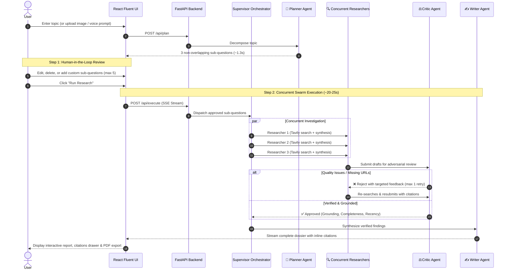

# Quorum 🤖


A high-performance, production-grade **multi-agent AI research platform** featuring **Human-in-the-Loop (HITL) sub-question editing**, adversarial fact-checking, and real-time Server-Sent Events (SSE) streaming.

Quorum decomposes complex research topics into focused sub-questions, gives you direct editorial control over the inquiry plan, dispatches concurrent research swarms, subjects drafts to skeptical critic review, and synthesizes cited research reports in **~20–25 seconds** (optimized from 16+ minutes — a **42x speedup**).

---

## ⚡ Interactive Workflow: Human-in-the-Loop (HITL)

Unlike black-box research agents that run blindly end-to-end, Quorum introduces a **two-step interactive workflow**:



---

## 🧠 The Agent Swarm

Each agent role is strictly constrained with role-specific system prompts, model routing, and Pydantic validation:

| Agent | Primary Model | Role & Constraints |
|---|---|---|
| **🧠 Planner Agent** | `gemini-flash-lite-latest` | Deconstructs broad topics into exactly 3 focused, non-overlapping sub-questions. Extracts text from multimodal screenshot/handwritten image inputs. |
| **🔍 Researcher Agent** | `gemini-3.5-flash-lite` | Uses Tavily live web search tool. Strictly restricted to concise, fact-dense findings (200–400 words) with **mandatory inline citations**. |
| **⚖️ Critic Agent** | `gemini-3.1-flash-lite` | Grades research out of 1.0 on **Grounding**, **Completeness**, and **Recency**. Rejects unsupported claims and missing URLs to enforce zero hallucinations. |
| **✍️ Writer Agent** | `gemini-flash-lite-latest` | Merges overlapping findings, preserves citations, and synthesizes an executive summary, comparative matrices, and key takeaways (token-capped at 1,500 tokens). |
| **⚡ Supervisor** | Pure Python | Manages concurrency via `ThreadPoolExecutor`, enforces retry budgets, routes SSE log events, and collects telemetry metrics without LLM overhead. |

---

## 🚀 42x Speed Optimization Architecture

In our latest performance engineering release, total research latency was reduced from **991s (~16.5 minutes) to 23.3 seconds**:

1. **Ultra-Low Latency Model Routing**: Replaced throttled/overloaded models with responsive, high-concurrency lite models (`gemini-flash-lite-latest`, `gemini-3.5-flash-lite`, `gemini-3.1-flash-lite`), eliminating 10+ cascading fallback timeouts.
2. **Tool Step-Limit Resolution**: Resolved a step-limit termination flaw in `_ask_with_tools` by automatically prompting the model to synthesize findings from accumulated searches rather than returning an error string.
3. **Mandatory Citations on Attempt 1**: Enforced strict URL inclusion in the Researcher prompt, eliminating round-1 Critic rejection loops.
4. **Token Capping & Input Truncation**: Capped Writer output to 1,500 tokens and truncated input findings to 1,500 characters, preventing runaway generation.
5. **Concurrent Asynchronous Threads**: All sub-questions are researched in parallel threads via Python `ThreadPoolExecutor`.

---

## 🛠️ Tech Stack

- **Backend**: FastAPI, Uvicorn, Python 3.10+, `sse-starlette`, `xhtml2pdf`, `pydantic` v2
- **Frontend**: React 18, Vite, TypeScript, Tailwind CSS, Framer Motion, Lucide Icons, Marked
- **LLM & Search APIs**: Google GenAI SDK (`google-genai`), Tavily Search API
- **Persistence & Auth**: Supabase (PostgreSQL with Row-Level Security), SQLite session archive, ChromaDB vector store

---

## 💻 Getting Started

### Prerequisites
- Python 3.10+
- Node.js 18+ and npm
- A [Google Gemini API Key](https://aistudio.google.com/)
- A [Tavily Search API Key](https://tavily.com/)

---

### 1. Clone & Setup Environment

```bash
git clone https://github.com/Manvendrasingh2005/Quorum.git
cd Quorum
```

Create and configure your `.env` file in the project root:
```env
GEMINI_API_KEY=your_gemini_api_key_here
TAVILY_API_KEY=your_tavily_api_key_here
```

---

### 2. Backend Setup & Launch

```bash
# Create and activate virtual environment
python -m venv venv

# On Windows:
.\venv\Scripts\activate
# On macOS/Linux:
source venv/bin/activate

# Install dependencies
pip install -r requirements.txt

# Start the FastAPI backend server
uvicorn api:app --host 127.0.0.1 --port 8000
```
Backend health check is available at: `http://127.0.0.1:8000/api/health`

---

### 3. Frontend Setup & Launch

In a separate terminal:
```bash
cd frontend

# Install frontend dependencies
npm install

# Start the Vite development server
npm run dev
```

Open **[http://localhost:5173](http://localhost:5173)** in your browser.

---

### 4. Alternative Streamlit Dashboard

If you prefer the standalone single-process dashboard:
```bash
streamlit run app.py
```

---

---

## 🐳 Production Containerization (Docker Compose)

Quorum provides a multi-container production stack orchestrating the FastAPI backend and Nginx-powered React frontend with zero manual configuration.

### One-Command Deployment

```bash
docker compose up --build -d
```

- **Frontend Gateway**: [http://localhost:3000](http://localhost:3000) (Nginx with SSE streaming optimization & SPA routing)
- **Backend API**: [http://localhost:8000](http://localhost:8000) (Uvicorn ASGI runner)
- **Telemetry & Health Metrics**: [http://localhost:8000/api/metrics](http://localhost:8000/api/metrics)
- **API Health Check**: [http://localhost:8000/api/health](http://localhost:8000/api/health)

To inspect logs:
```bash
docker compose logs -f
```

---

## 🔭 Real-Time Observability & Structured Telemetry

Quorum includes built-in OpenTelemetry-compatible tracing and structured JSON logging for enterprise production monitoring:

1. **Correlation IDs (`X-Correlation-ID`)**: Every HTTP request is assigned a unique UUID propagation header tracked across all downstream agent calls.
2. **Structured JSON Logs**: Formatted for Datadog, Grafana Loki, or CloudWatch:
   ```json
   {
     "timestamp": "2026-10-19T18:32:55.661997+00:00",
     "level": "INFO",
     "logger": "quorum.telemetry",
     "message": "GET /api/metrics - 200 (3.1ms)",
     "service": "quorum-ai",
     "event": "http_request",
     "status_code": 200,
     "latency_ms": 3.06,
     "trace_id": "e7f0c921-dcb1-486d-bb76-d120252a2bfc"
   }
   ```
3. **Agent Latency Spans (`AgentSpan`)**: Measures granular execution durations for Planner, Researcher, Critic, and Writer agents.
4. **Adversarial Audit Statistics**: Real-time tracking of Critic approval vs. rejection rates to detect prompt drift and hallucination risks.

Inspect metrics live via `GET /api/metrics`.

---

## 📊 Offline Evaluation Suite

Measure Quorum's multi-agent performance against a single-prompt baseline on Factual Accuracy, Citation Quality, Recency, and Completeness:

```bash
python -m src.evaluation.evaluator
```

---

## 📁 Repository Structure

```
research-agent/
├── api.py                     # FastAPI backend (JobManager, SSE streaming, DOCX/PDF export, /api/metrics)
├── Dockerfile                 # Multi-stage lightweight Python 3.11 backend Dockerfile
├── docker-compose.yml         # Production multi-service orchestration (Backend + Frontend)
├── .dockerignore              # Clean container build exclusions
├── src/
│   ├── config.py              # Centralized role model routing & depth mode presets (Flash, Standard, Deep)
│   ├── observability/         # Structured JSON logging, telemetry store, and AgentSpan tracers
│   │   ├── __init__.py
│   │   └── telemetry.py
│   ├── orchestrator/
│   │   ├── supervisor.py      # Pure-Python orchestrator, concurrent executor & metrics
│   │   └── job_manager.py     # Asynchronous job queue, event buffer & reconnectable SSE engine
│   ├── agents/
│   │   ├── base.py            # Base agent with retry fallback, token caps & tool loop
│   │   ├── planner.py         # Planner agent (multimodal topic decomposition)
│   │   ├── researcher.py      # Researcher agent (Tavily search & fact drafting)
│   │   ├── critic.py          # Critic agent (adversarial grounding & verification)
│   │   └── writer.py          # Writer agent (token-capped synthesis & citation formatting)
│   ├── tools/
│   │   ├── search.py          # Tavily search tool wrapper
│   │   └── pdf.py             # URL PDF reader tool
│   ├── models/
│   │   └── schemas.py         # Pydantic schemas (verdicts, findings, reports)
│   └── memory/                # SQLite & ChromaDB vector store integration
└── frontend/                  # React 18 + Vite production application
    ├── Dockerfile             # Multi-stage Node.js build to Nginx Alpine runner
    ├── nginx.conf             # Production Nginx reverse proxy with SSE stream optimizations
    ├── .dockerignore          # Frontend container build exclusions
    └── src/
        ├── App.tsx            # Main application coordinator & view router with permalink restoration
        ├── pages/
        │   ├── PlanReviewView.tsx    # Step 1: HITL sub-question editor
        │   ├── ResearchRunView.tsx   # Step 2: Live SSE swarm monitor, DOCX export & favicon sources
        │   ├── AppShell.tsx          # Workspace & query submission interface with depth selector
        │   └── LandingPage.tsx       # Obsidian-aesthetic landing page
        └── lib/
            ├── api.ts         # Typed API client with reconnectable SSE, DOCX export, and citation verification
            └── supabase.ts    # Supabase authentication & history persistence
```

---

## 📄 License

This project is licensed under the MIT License.
