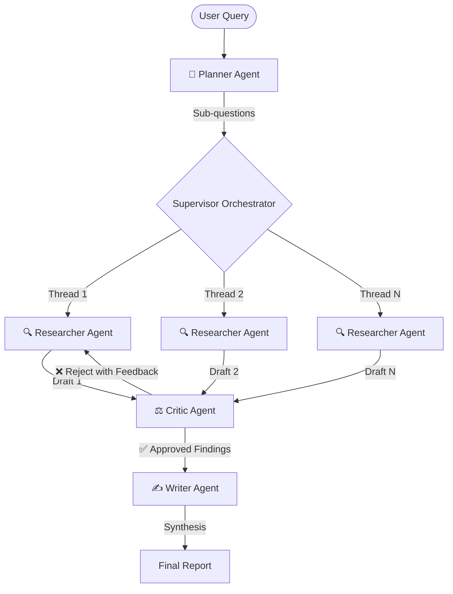

# Quorum 🤖


A production-grade, multi-agent AI research pipeline that autonomously plans, researches, reviews, and synthesizes complex topics. Built to demonstrate advanced LLM orchestration, structured data validation, and agent reflection techniques.

---

## 📐 System Architecture

Instead of a single brittle API call, MARS features an orchestrated graph of specialized agents. A pure-Python `Supervisor` handles routing, concurrency, and retries, separating control-flow logic from LLM generation.



### 🧠 Core Agents
1. **Planner Agent**: Decomposes the user's high-level topic into 3-5 distinct, non-overlapping sub-questions.
2. **Researcher Agent**: Has access to a `search_web` tool. It queries live data, reads multiple sources, and drafts heavily-cited answers.
3. **Critic Agent**: The cornerstone of the system. It blindly scores the Researcher's drafts out of 1.0 on:
   - **Grounding**: Are claims backed by citations?
   - **Completeness**: Does it fully answer the prompt?
   - **Recency**: Are the sources up to date?
   
   *If the draft fails the threshold, the Critic rejects it and sends the Researcher back to the web with specific revision instructions.*
4. **Writer Agent**: Synthesizes the approved, high-fidelity findings into a cohesive final Markdown report.

---

## ✨ Features

- **Strict Structured Outputs**: Every LLM interaction is enforced via `Pydantic` schemas. If an agent hallucinates invalid JSON, it immediately triggers an error-correction prompt retry loop.
- **Asynchronous Execution**: Researchers run concurrently via `ThreadPoolExecutor`, dramatically reducing wall-clock latency for complex queries.
- **Persistent Semantic Memory**: Uses `ChromaDB` (powered by Gemini embeddings) to map past verified answers. If you ask a similar question, the Researcher retrieves the cached answer directly from the vector store—bypassing the web and LLM entirely.
- **Session History**: All completed reports are saved to a local `SQLite` database and accessible in the Streamlit sidebar.
- **LLM-as-a-Judge Evaluation Suite**: Includes an offline evaluation script measuring System vs. Baseline (single-prompt) performance on Factual Accuracy and Citation Quality metrics.

---

## 🚀 Getting Started

### Prerequisites
- Python 3.10+
- A Google Gemini API Key
- A Tavily API Key (for web searching)

### Installation
1. Clone the repository:
   ```bash
   git clone https://github.com/yourusername/multi-agent-research-system.git
   cd multi-agent-research-system
   ```

2. Create a virtual environment and install dependencies:
   ```bash
   python -m venv venv
   source venv/bin/activate  # On Windows: .\venv\Scripts\activate
   pip install -r requirements.txt
   ```

3. Configure your API keys in a `.env` file at the root:
   ```env
   GEMINI_API_KEY=your_gemini_key_here
   TAVILY_API_KEY=your_tavily_key_here
   ```

### Running the Application

Launch the real-time Streamlit dashboard:
```bash
streamlit run app.py
```

### Running the Evaluation Suite
Measure the Multi-Agent system's performance against a baseline:
```bash
python -m src.evaluation.evaluator
```

---
*Built as a demonstration of production-grade Agentic Engineering.*
